<div align="center">

# OpenGym · 我的健身记录

### 记录训练，认真吃饭，也和一起坚持的人互相鼓励。

基于 **[DuarteSantos8/openGym](https://github.com/DuarteSantos8/openGym)** 的中文二次开发，<br>
在原有训练工具之上，加入 **饮食记录、AI 计划助手、健身社区与移动端体验优化**。

[](LICENSE)
[](https://github.com/DuarteSantos8/openGym)
[](#界面预览)

[演示视频](#57-秒了解这个版本) · [二次开发改进](#相较原版新增与改进了什么) · [界面预览](#界面预览) · [本地运行](#本地运行) · [部署](#部署自己的实例) · [原版说明](README.upstream.md)

</div>

> **项目来源说明**：本仓库由 [linyuchao123](https://github.com/linyuchao123) 基于开源项目 **openGym** 二次开发，并非从零开发，也不是原作者的官方分支。感谢原作者 **DuarteSantos8** 及所有贡献者提供的训练记录、计划、动作库、统计和自托管基础。本项目保留原许可证与署名；新增和修改部分按仓库许可证提供。

## 2026-10-25：作者与共建社区

首页新增时间问候和「认识作者」，集中展示项目初心、作者联系方式、共建群与更新日志。新账号欢迎引导加入共建邀请，普通成员隐藏日常同步诊断，保存异常仍会提醒。投稿信箱支持后台查看反馈内容、提交者昵称和账号编号。[实施与验证说明](docs/AUTHOR_COMMUNITY_20261025.md)。

## 2026-10-25：让日常记录更直观

新增固定格子热力图、顶部照片／地点打卡、训练前预览确认和更明显的称重入口；周报加入训练、饮食和体重图表，可免费导出两种海报或排版TXT，主动点选时才使用AI编排。饮食现在分为 **今日记录／饮食计划／食物库／趋势**，支持自定每日、训练／休息日及按周目标。

详见 **[体验升级与验收说明](docs/SPORTS_DASHBOARD_20261025.md)**，内含两套虚构数据生成的海报示例、隐私范围与手机验收边界。

## 本轮新增：让训练记录成为成长档案

- **更容易开始**：首页优先显示继续/开始训练，目标与经验独立选择，场地和每周天数可调整；引导可跳过，手动记录和入门模板始终可用。
- **更值得回看**：个人页新增概览与成长，统计有效训练、四周频率和里程碑，连接既有个人纪录；自报成就与系统统计分开，修改或删除训练后会重新计算。
- **更可控地分享**：可保存成果图；站外分享默认关闭，由作者选择昵称、目标和训练统计后开启。公开页面不含身体、饮食、私信或R2素材，关闭或更换配置后旧链接失效，页面不主动开放搜索收录。
- **更有秩序地交流**：新增问题交流分类；动态、评论和成员可举报，管理员有处理队列与记录；用户可提交使用反馈。已有挑战、训练卡片与互关私信继续复用。
- **更可靠地增长**：支持累计1000人的邀请码，按用户保存训练、按动态处理关键社区写入，SQL分页查询；后台区分访问与有效记录，观察留存、服务失败和D1读写量，AI增加站点月调用额度。

完整实现、接口、隐私范围、验证方法和待完成事项见 **[本轮实施与验收记录](docs/NEXT_STAGE_IMPLEMENTATION.md)**。移动网页包与Android资源检查已通过；当前尚未完成签名安装包、安卓/iOS真机矩阵和商店发布，不能把网页或本地测试结果等同于原生App已上线。

## 为什么做这个版本

一开始，只是想要一个自己用得顺手的健身记录工具：训练时能快速记组数和重量，吃饭时能随手记录，回头还能看到自己的变化。

在 openGym 已有基础上，这个版本逐步把 **「安排训练 → 完成训练 → 记录饮食与体重 → 查看进步 → 分享日常」** 连在一起。既能保留个人数据，也能和熟悉的朋友交流；需要帮助时，可以让 AI 参与制定计划，再由自己确认和调整。

**你可以把它当作自己的健身档案，也可以部署成一个邀请制的小型健身社区。**

### 从一次训练，到一份长期积累的健身档案

- **训练前，知道今天练什么。** 沿用上游的训练计划和动作库，按肌群、器械选择动作；本版本补充中文默认体验和 AI 计划助手，可结合个人目标、训练经验、可用器械与时间生成草案，继续对话调整，确认后应用到计划。
- **训练中，把每一组留下来。** 记录动作、组数、次数与重量，保留训练历史；首页把计划、当日训练、饮食和体重入口放在一起，减少在不同页面寻找功能的步骤。
- **训练外，把吃饭也纳入记录。** 新增餐食照片、手动食物记录、热量与三大营养素汇总；常吃的一餐可以收藏、调整份量后复用，也能按日期回顾。AI 估算是辅助，最终内容由使用者确认保存。
- **回头看，看到自己的坚持。** 沿用热力图、体重趋势与肌肉统计，结合新增的训练＋饮食周报、个人资料与目标，让训练和日常记录有连续的上下文。
- **想分享时，找到一起坚持的人。** 新增图文视频动态、关注、点赞、评论回复、收藏与作品主页；互相关注后可以私信，消息中心集中查看互动提醒，进入后自动清除已有未读提示。

### 不只是功能增加，也补齐日常使用细节

本版本还改进了个人资料的保存与刷新一致性、粉丝计数和名单的对应关系、私信头像比例、移动端媒体上传与播放、未读状态同步等细节。Cloudflare 部署方式新增昵称＋密码登录，供不支持通行密钥的浏览器使用；通行密钥是否可用仍取决于设备、系统和浏览器能力。

对自行部署的人，仓库提供 Workers、D1 与私有 R2 的部署实现和配置模板，包含邀请管理、成员管理、媒体配额与上传清理。使用者可以建立个人健身档案，也可以邀请朋友组成小型社区；具体服务能力与上限见下方功能表和部署文档。

## 57 秒了解这个版本

点击下方播放器的 **▶ 播放按钮**，即可在线观看；视频包含 **合成解说与背景配乐**，可调节音量、拖动进度或全屏观看。

https://github.com/user-attachments/assets/4fab8651-fef5-4047-8863-2f09e524f3d1

约 **57 秒 / 1080 × 1920 / 8 MB**。GitHub 播放器初始为静音，点击右下方的 **扬声器图标** 取消静音，即可听到解说和配乐；同时请确认设备音量。

[打开视频附件](https://github.com/user-attachments/assets/4fab8651-fef5-4047-8863-2f09e524f3d1) · [下载 MP4](https://github.com/linyuchao123/OpenGym/raw/refs/heads/main/docs/media/opengym-demo.mp4) · [仓库中的原始视频](docs/media/opengym-demo.mp4)

演示画面基于功能截图制作，配音为合成声音。完整 MP4 同时保存在仓库中，方便下载和离线观看。

## 相较原版，新增与改进了什么

**原版已有的优秀能力继续保留，本次改进主要集中在下面这些部分。**

| 方向 | 本次二次开发的新增与改进 |
| --- | --- |
| **中文与日常入口** | 默认中文、中文入门训练日、减少默认英文干扰；将首页、饮食、开始训练、社区、我的整合为移动端常用入口。沿用上游多语言和动作库，不把原有翻译成果算作本项目原创。 |
| **饮食记录** | 新增拍照／选图记录餐食、手动录入和修改食物、热量与蛋白质／碳水／脂肪统计、常吃餐收藏与复用、按日期回顾，以及训练＋饮食周报。 |
| **AI 饮食辅助** | 接入配置的 DeepSeek 服务，辅助识别餐食并估算营养；结果可以修改，确认后再保存，避免将模型输出直接当作准确事实。 |
| **AI 训练计划助手** | 读取本人选择的身高、体重及 BMI，结合训练场地、器械、经验、每周安排和强化部位生成草案；支持参考照片、继续修改、终稿确认，再把动作、组数、次数、休息和日程一键应用到训练计划。 |
| **个人资料与隐私** | 新增头像、个人介绍、性格／MBTI、身高体重、BMI 参考及资料公开选项；个人主页分行展示介绍、作品和社交数据，体重与首页同步。 |
| **邀请制健身社区** | 新增图文／视频日常、发现与关注、作品主页、点赞、分层评论与回复、收藏、站内动态转发，以及可选配乐和基础创作效果。 |
| **伙伴与消息** | 新增关注／粉丝列表、互关私信、表情与站内动态卡片、屏蔽、消息中心和未读数；进入消息中心自动清除已有提醒，之后的新消息继续提示。 |
| **新用户体验** | 新增首次使用公告与引导，介绍网站初心、主要功能和使用路径，降低第一次打开的操作门槛。 |
| **Cloudflare 部署** | 新增 Workers＋D1＋私有 R2 实现，复用业务与权限代码；包含数据迁移、版本冲突检查、分片上传、配额预留、过期上传清理与部署前检查。 |
| **媒体与手机体验** | 社区视频上传上限 200 MiB、照片 20 MiB；支持上传进度、失败重试和断点续传、Range 分段读取、视频 fast-start 处理、图片内存缓存与按需加载。播放速度仍取决于网络和视频编码。 |
| **账号与管理** | Cloudflare 版保留通行密钥，并增加昵称＋密码作为不支持 WebAuthn 的安卓等浏览器的登录方式；邀请默认 10 人、可单独扩容至 100 或 1000 人，支持停用账号、查看成员和最近活跃。 |
| **细节修复** | 修复个人资料刷新后被覆盖、粉丝总数与列表不一致、私信头像被拉宽、旧未读请求恢复红点等问题；增加相应回归检查。 |

### 原版能力，我们继续沿用

- 训练计划、固定周／轮换安排、动作选择、组数／次数／重量和训练历史。
- 动作库、动作演示、按肌群与器械筛选、自定义动作。
- 体重记录、训练热力图、进度统计、肌肉平衡／疲劳／力量视图。
- 原项目的备份与导入导出、设备数据与账号同步、自托管和通行密钥基础。

**尤其是截图里的动作库、训练热力图、肌肉图和部分统计视图，主要来自上游能力；本项目在其上做中文默认、生活数据整合和界面衔接。** 上游完整功能介绍见 [原版 README](README.upstream.md)。

## 界面预览

以下为实际使用截图，展示深色主题与绿色强调色；界面也支持其他外观设置。截图中的昵称、头像、体重、训练状态和社交计数是展示素材，不是新部署实例的预置数据。

### 首页、训练进度与身体记录

<table>
<tr><th>首页 · 今日概览</th><th>训练热力图与本周进度</th><th>体重趋势与 BMI</th></tr>
<tr>
<td>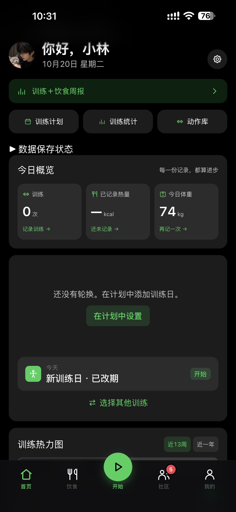</td>
<td>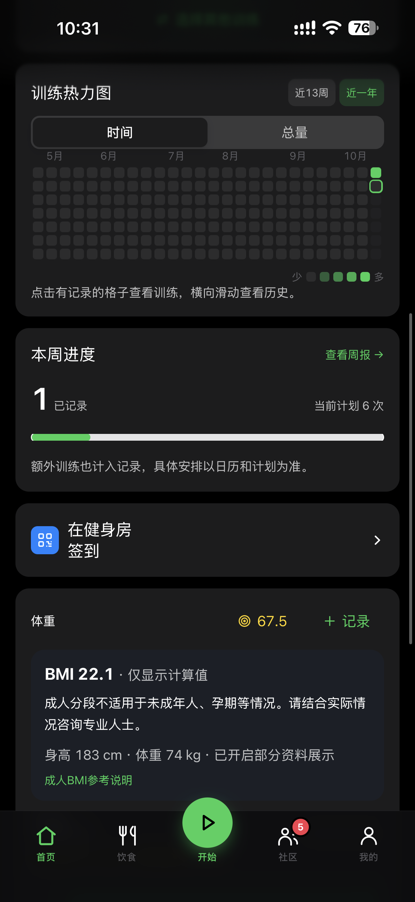</td>
<td>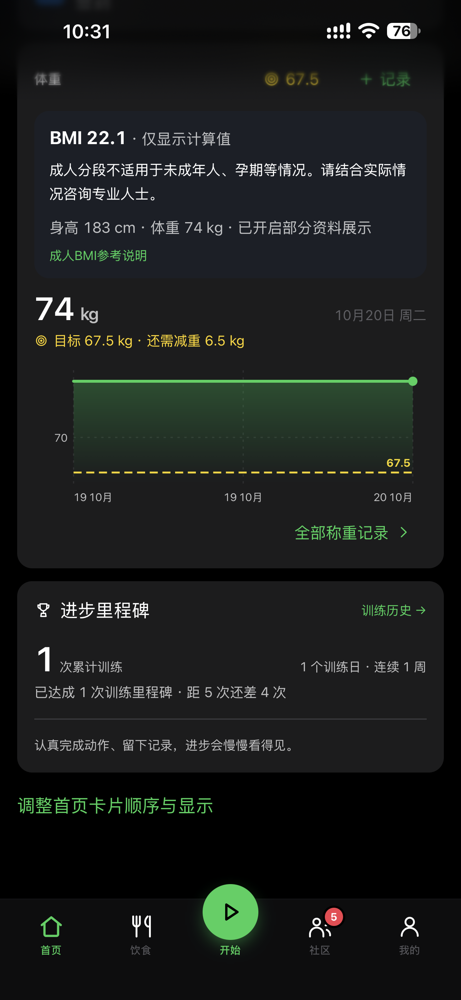</td>
</tr>
</table>

### 饮食、训练日与动作库

<table>
<tr><th>饮食记录与营养概览</th><th>训练日与计划入口</th><th>动作搜索与筛选</th></tr>
<tr>
<td>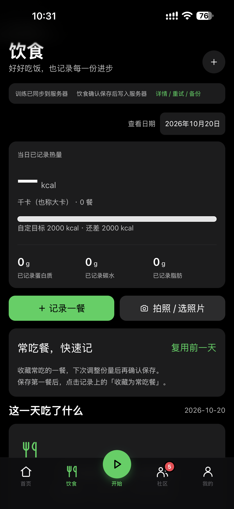</td>
<td>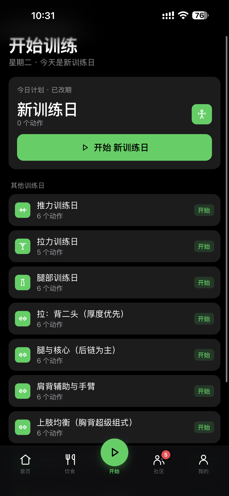</td>
<td>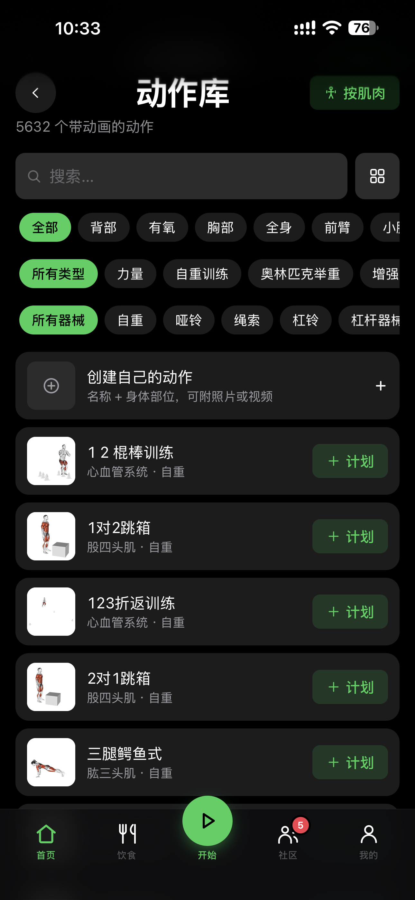</td>
</tr>
</table>

### 统计与肌群视图（沿用上游基础）

<table>
<tr><th>肌肉平衡、疲劳与力量</th><th>训练统计与历史</th></tr>
<tr>
<td>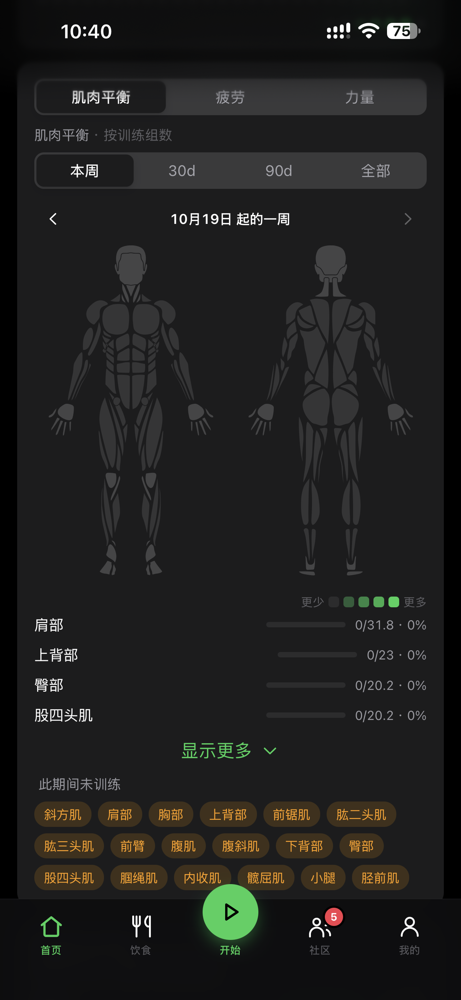</td>
<td>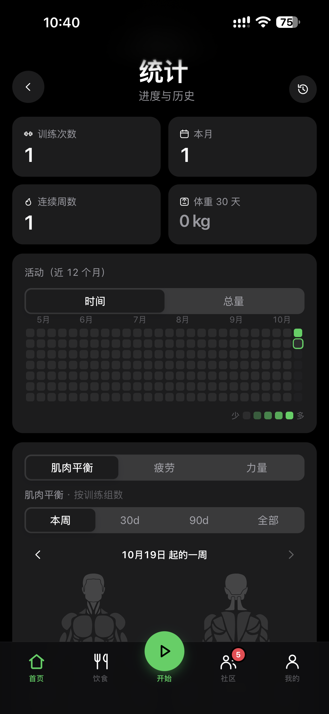</td>
</tr>
</table>

### 新增社区与个人主页

<table>
<tr><th>健身日常 · 沉浸式浏览</th><th>个人资料 · 作品与消息</th></tr>
<tr>
<td>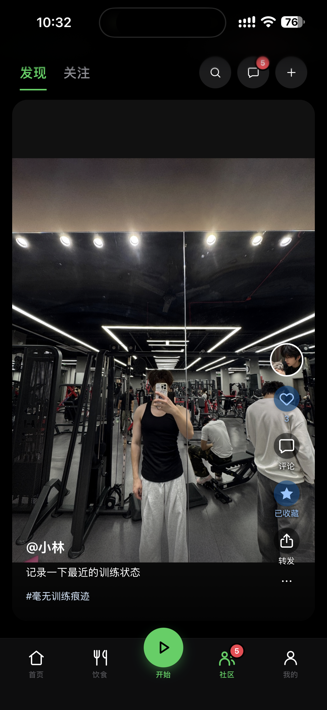</td>
<td>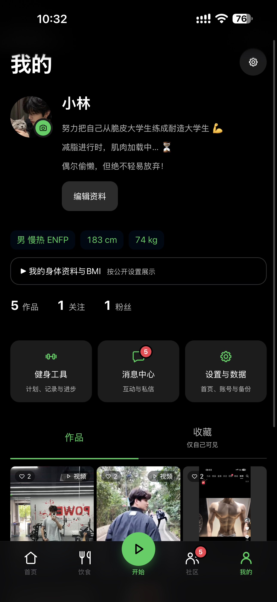</td>
</tr>
</table>

<details>
<summary>查看仓库创建截图与全部演示素材</summary>

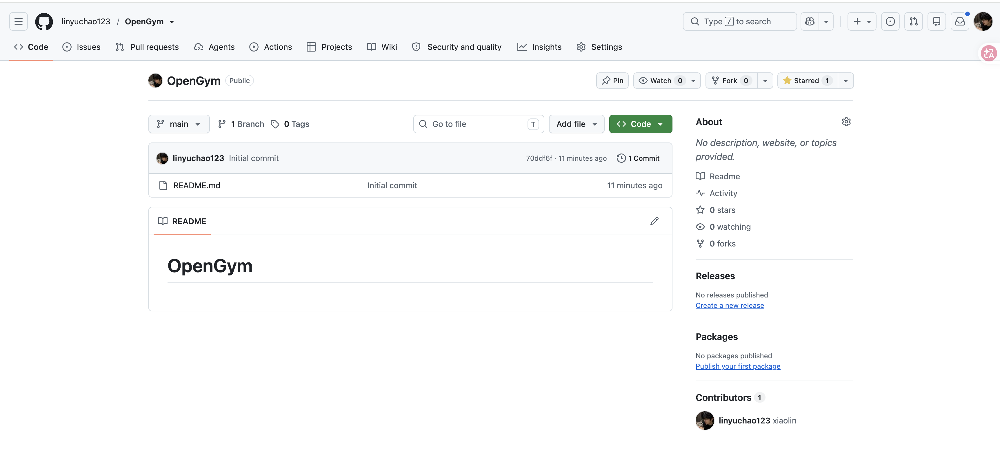

全部图片和视频位于 [docs/media](docs/media)。

</details>

## 你可以怎样使用

1. **先安排训练**：从已有计划开始，或让 AI 根据你的时间、器械与偏好生成草案，确认后应用。
2. **训练时快速记**：进入训练日，逐组记录重量与次数；历史、统计和热力图帮助回看。
3. **吃饭时随手记**：拍照辅助识别，或直接输入；核对分量后保存，常吃的一餐下次复用。
4. **定期看变化**：记录体重，查看训练与饮食周报，结合自己的感受调整安排。
5. **和朋友一起坚持**：通过邀请加入，分享健身日常、互相关注和交流，给坚持一点陪伴。

体验站：[opengym.xiaolinyx.me](https://opengym.xiaolinyx.me)。站点采用邀请制，源码开源不等于开放注册；请向站点管理员申请邀请，不在仓库公开有效邀请码。

## 本地运行

推荐 **Node.js 22.12+ / npm**。在仓库根目录运行：

```sh
git clone https://github.com/linyuchao123/OpenGym.git
cd OpenGym
npm --prefix frontend ci --ignore-scripts
npm --prefix api ci --omit=optional
npm run dev:zh
```

打开 <http://localhost:13000>。此命令只监听本机，前后端一起启动；`Ctrl+C` 结束。端口冲突时可改为：

```sh
GYM_DEV_PORT=13010 GYM_API_PORT=13011 npm run dev:zh
```

- 本地账号数据位于 `.local-data/`，不应提交 Git。
- 首次本地启动按开发配置创建自己的档案，不包含截图中的真实账号和记录。
- AI 为可选能力。参考 [.env.ai.local.example](.env.ai.local.example) 创建自己的 `.env.ai.local`；API 密钥只放在后端环境，不能放进前端或 README。
- 如果想在本地开启密码登录，可使用 `PASSWORD_LOGIN=1 npm run dev:zh`。已有账号仍需本人确认后设置密码。
- 上游可选 AI 教练和本项目新增的 AI 计划助手是不同入口；未配置服务时，不应把演示画面当作真实推理结果。

中文本地／Docker 说明见 [README.zh-CN.md](README.zh-CN.md)，上游通用部署说明见 [docs/SELF_HOSTING.md](docs/SELF_HOSTING.md)。

## 部署自己的实例

### 方案一：Docker / 自有服务器

从当前修改版源码构建，使用 [compose.zh.yml](compose.zh.yml) 和 [.env.zh.example](.env.zh.example)。配置自己的域名、HTTPS、`ORIGIN`、`RP_ID`，再创建正式账号；需要密码登录时显式启用 `PASSWORD_LOGIN=1`。

```sh
cp .env.zh.example .env.zh
docker compose --env-file .env.zh -f compose.zh.yml up -d --build
```

仅部署静态前端不能提供账号、私信和服务器同步。正式数据目录需要持久化和备份，公网入口建议使用 HTTPS。

### 方案二：Cloudflare Workers / D1 / R2

新增的云端实现位于 [cloudflare](cloudflare)：Workers 处理 API，D1 保存账号和记录，私有 R2 保存新的社区与饮食素材。使用自己的资源、域名与 Secret，详见 [Cloudflare 部署说明](cloudflare/README.md)。

- 视频以分片方式上传，不把 200 MiB 文件一次塞进 Worker 请求。
- 素材读取经过登录与可见性校验，R2 桶默认不公开。
- 默认每用户 1 GiB、站点 8 GiB 的素材限额是应用配额，不是账单硬上限。
- Workers、D1 和 R2 有各自免费额度；R2 超额与 AI 服务可能计费，不能理解为无限免费。
- 新社区通道与旧训练附件通道的限制不同；服务端不进行通用视频转码。

## 当前边界与隐私说明

- **抖音／汽水音乐曲库尚未接通。** 现有功能是站内配乐、自有／已获授权 MP3，以及保留视频原声；没有声称具备抖音推荐或收藏曲库授权。接口配置和诊断入口不等于已获得内容授权。
- 有声自动播放受浏览器策略限制，可能需要先点一次开启声音；无法保证所有手机无交互自动有声。
- 通行密钥需要浏览器与系统密码管理器支持；不支持 WebAuthn 的浏览器可以使用密码入口，但仍需正常的 HTTPS、Cookie 和网络环境。
- AI 只在本人确认后接收选定资料／图片，处理受服务提供方政策约束；不会自动发布到社区，也不能承诺第三方“绝对匿名”。
- 食物热量、BMI 与 AI 训练建议仅作一般记录和参考，不是体脂测量或医疗诊断。参考照片不能保证某种体型或训练结果。
- 当前截图和视频展示的是网页版本，不代表本仓库已发布独立安卓／iOS 安装包。上游原生 App、AI 教练、系统推送和部分管理接口在不同部署方式中的支持范围不同，见部署说明。

## 开发与检查

新增业务测试位于 `api/test`、`frontend/src` 和 `cloudflare/test`。例如：

```sh
node --test api/test/lifestyle.test.js api/test/invitation-limits.test.js
npm --prefix frontend test -- src/views/Notifications.read.test.jsx src/lib/unread.test.js
npm --prefix frontend run build
npm --prefix cloudflare ci --ignore-scripts
npm --prefix cloudflare test
```

Cloudflare 原生集成测试会启动本地服务、创建临时 D1 和测试账号，使用软件通行密钥；需要安装相应依赖和可用本地端口。测试不会替真实用户操作 Face ID，也不会写入正式数据库。Node.js 26 若受实验性 Web Storage 干扰，可在前端测试时添加 `NODE_OPTIONS=--no-experimental-webstorage`。

## 目录速览

```text
frontend/           React 页面、移动端交互、媒体播放和本地状态
api/                Node API、新增生活数据业务、AI 和权限校验
cloudflare/         Workers、D1、R2 实现及迁移、原生运行时测试
catalogue/          沿用上游的动作资料与授权媒体
scripts/            中文开发入口、素材准备和辅助脚本
docs/media/         本仓库演示视频与功能截图
README.upstream.md  保留的上游原始项目介绍
```

## 致谢与许可

- 原项目：**[DuarteSantos8/openGym](https://github.com/DuarteSantos8/openGym)**，感谢 DuarteSantos8 和贡献者。
- 二次开发基线：[`e348fc17c42c7e9a211c5972e573ad3698190ee2`](https://github.com/DuarteSantos8/openGym/commit/e348fc17c42c7e9a211c5972e573ad3698190ee2)，上游前端版本 `1.4.1`。这不是本仓库独立发布的版本号。
- 代码许可：**AGPL-3.0-or-later**，详见 [LICENSE](LICENSE)；同时保留上游各目录适用的版权及许可声明。
- **动作演示图片和视频不是 AGPL 素材。** Gym visual 媒体遵循 [catalogue/media/NOTICE.md](catalogue/media/NOTICE.md) 的单独授权，仅限声明允许的 openGym 内使用；不得从本仓库提取到独立网站、App 或商业产品，也不得作为 AI 训练素材。需要其他用途请自行获得授权。
- 演示截图与宣传视频作为本仓库展示资料，不会因此自动授予其中人物肖像、音乐或其他第三方内容的再利用权。

欢迎反馈问题和交流改进。希望这个版本让每天的一点努力，更容易被记录，也更容易坚持下去。
