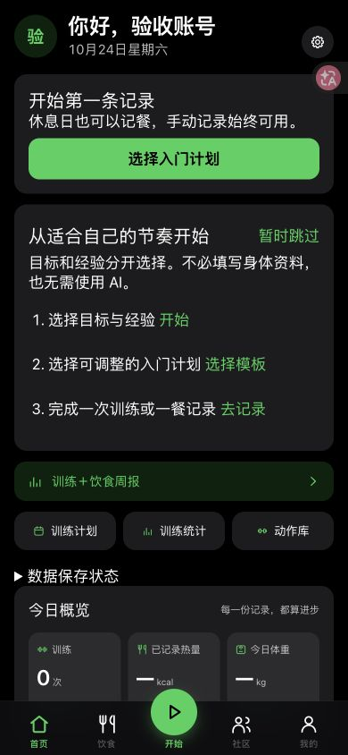

# OpenGym 下一阶段：实施与验收记录

2026-10-24。本批在现有中文二次开发上实现，继续使用 Cloudflare Workers / D1 / 私有 R2；保持免费，未购买服务器、商店账号或付费服务。上游仍为 DuarteSantos8/openGym，许可证和署名不变。

## 已交付的入口与行为

| 方向 | 实现 | 入口 |
| --- | --- | --- |
| 邀请扩容 | 共享校验、Node、Cloudflare 支持累计 1–1000 人；默认10人，管理页支持100/1000；拒绝低于已使用人数，撤销继续生效 | 管理员 → 邀请码与其他管理工具 |
| 首页 | 首屏明确继续训练、今日训练或选择入门计划；轮换空状态改为紧凑设置入口 | 首页 |
| 可跳过引导 | 分别记录目标与经验，收集场地/器械范围、每周天数；身体资料可跳过；不依赖AI；不强迫已有用户重填 | 首页 → 从适合自己的节奏开始 |
| 成长档案 | 概览、成长、动态及保留的私人收藏；累计有效训练、训练日、四周频率、阶段里程碑、既有个人纪录入口 | 我的 → 成长；伙伴主页 |
| 可控分享 | 默认关闭；作者选择昵称、目标和/或成长统计后开启；独立匿名只读页面、随机链接；修改选择会更换链接，关闭即失效 | 我的 → 成长 → 站外分享设置 |
| 成果图 | 生成可保存的 SVG 成果图，只含统计，不包含头像、身体或餐食数据 | 我的 → 成长 → 保存成果图 |
| 社区主题 | 保留日常，支持训练、饮食、进步和新增的问题交流；既有训练卡片由用户主动发布 | 发布动态 / 社区分类 |
| 人工管理 | 动态、评论、成员举报；待处理/已处理/驳回、处理记录；可移除被举报动态/评论 | 举报；平台管理 → 社区举报与反馈 |
| 使用反馈 | 用户填写具体问题，管理员查看；每天最多3条 | 我的 → 设置与数据 → 使用反馈 |
| 安装说明 | Safari、安卓浏览器和微信外部打开说明，浏览器支持时提供安装按钮；说明实际离线边界 | 我的 → 设置与数据 → 添加到手机主屏幕 |
| 成本和指标 | AI站点月调用总数默认300次，可配置；有效使用/留存分组、社区参与及服务质量聚合 | 平台管理 → 实际记录与留存 |

入门偏好用于保留用户的目标和经验，模板仍由本人选择、调整；本批没有声称可以自动决定个性化训练方案。上次逐组参考、训练草稿、常吃餐、饮食复用、周报、训练卡片和挑战复用了已有实现。

## 数据访问与并发

- `/api/data` 按用户读取、比较原记录并保存，跨用户不再争用整站训练版本号；同一用户两设备的陈旧写入继续返回409。
- 资料、饮食、常吃餐按当前用户载入和提交；保留本机待同步队列、失败重试和资料版本校验。
- 社区列表按条件在SQL中筛选、计数、游标分页；只读取该页、原动态及必要的作者、屏蔽和素材资料。
- 成员目录和伙伴主页读取公开资料投影、关系图和统计，不载入别人的饮食明细；保留 `page`，增加 `cursor` 和 `next`。
- 私信按会话读取最近50条，支持历史游标；收件箱只读取当前用户参与的消息，通知只读取当前用户的通知。关系图仍用于一致的粉丝统计与屏蔽判定。
- 动态发布、点赞、评论及评论操作使用记录级事务。素材归属、屏蔽、原动态和相关通知状态也在事务中校验；同一条内容争用返回409。发布频率和通知数量通过相关成员的版本标记串行保护。
- 关注、屏蔽、挑战、AI预算、举报等涉及多记录约束的操作保留保守的作用域事务；没有为减少409而直接移除约束。收件箱仍会读取该用户的完整会话集合，后续可进一步优化大量会话的SQL聚合。
- 消息全部已读改为D1批量事务，能处理超过90条提醒；按打开页面时的回执确认，后到消息、其他账号的消息不被清除。通知列表分页显示，保留全部已读能力。
- 新索引和检查表均为增量迁移；不删除旧记录。不同记录仍共享必要的关系约束时可能出现409，界面保留内容和重试。

## 隐私与分享边界

匿名预览是 `GET /api/life/public-growth?token=…`，只输出作者勾选的标量字段和成长统计；HTML转义昵称，设置 noindex/nofollow/noarchive、no-store、no-referrer 和限制脚本的CSP。停用或删除账号、关闭分享、更换分享配置后原链接不再提供内容。

**本批没有开放站外动态原文、头像、身体照片、视频或其他R2素材。** 原有成员动态链接仍要求登录，匿名不能使用现有登录接口获取素材。这样无需开放R2桶，也不会借主页分享泄露私信、饮食或未选择的身体字段。后续若扩展动态/媒体匿名分享，必须另做逐素材授权和删除、撤销、停用的回归。

成长统计只计算含已完成非热身工作组、有效日期和实际次数/时长的保存训练；同一ID不重复计数，修改/删除后重新计算。自报成就单独标记，不生成虚假纪录。自己的成长页包含本机记录；公开链接读取服务器已同步记录。成果图保存给他人后无法远程收回，设置页已说明。

## 指标与预算

后台区分访问活跃与实际记录，展示人数、分母和比例：24小时内首次有效记录、近七天有效用户、至少两个记录日的用户、D7有效留存；按当前目标与经验分组。新有效训练的首次保存时间由服务端保留，重试/编辑不能改写成新日期。

历史记录缺少保存时间时以完成时间作有限回溯；导入、删除、缺失时间和样本未成熟都会影响统计。此版本不能把现存记录统计当成不可变的完整行为事件仓库。目标/经验分组使用当前资料，不代表注册时的原始分类。需要先观察至少两周基线，不能凭注册增长宣称留存已改善。

社区参与按最近七天的主页更新、主动发布、非本人至少两字的未删除评论统计。服务质量按小时聚合登录、训练/饮食保存、上传和列表的请求数、失败、冲突、平均/最大耗时及数据库读写行数，保留60天；不保存消息正文、IP、餐食照片或身体数值。质量写入失败不会阻断正常记录。

AI三个入口共用站点月调用预留，默认300次，配置 `AI_SITE_MONTHLY_CALLS=0` 可暂停新AI调用；已有每用户日限额继续有效。失败的已预留调用仍计数。**调用次数上限不等于人民币费用硬上限**；基础功能不依赖AI额度。现有媒体每人/本站总量限制不因邀请码扩容而增加。需要每周检查 Cloudflare 与AI提供商的真实用量和账单。

## 移动工程与实际边界

- Android applicationId、Capacitor appId、iOS bundle identifier 使用 `me.xiaolinyx.opengym`，发布名称为 OpenGym 社区；Java内部命名空间和原作者代码署名保留。
- Cloudflare补上现有移动客户端的一次性配对协议：已登录网页生成5分钟一次性码，兑换独立Bearer会话，退出或账号停用可撤销。仅允许预设本地WebView来源；Cookie不能直接当Bearer使用，浏览器的同源保护继续有效。
- 移动网页包已构建，Android资源同步及移动包检查已通过；这不等于APK已经编译、签名或真机验收。
- 当前没有配置 Android SDK，Gradle构建环境未准备好。iOS只有Command Line Tools，没有完整Xcode，也没有CocoaPods。尚未生成可交付的签名APK/IPA，未提交任何商店。
- 原生社区视频/配乐的私有媒体认证、系统返回、键盘、分享、上传和锁屏恢复，仍需在实际Android/iOS构建中逐项验证；不能仅凭网页和API测试称为原生App可发布。
- 上架前还须补齐/核验账号删除、隐私说明、审核账号、审核所需社区管理以及自己的签名和发布身份。没有购买开发者服务。

## 验证记录

本批所有模拟账号、动态和并发测试只在临时数据库运行，没有在正式站制造假用户。

2026-10-24 验证结果：Node 27 项、Cloudflare 46 项、前端 55 项，共 128 项通过；网页构建、移动网页资源同步和公开仓库脱敏/文档链接检查通过。正式站已发布，浏览器只读核对了新首页、成长页、使用指标、举报管理和邀请码累计1000名额。此批交付为本方案的基础实现，后续原生真机验收、阶段照片/置顶、完整行为事件与社区主题运营仍按下方清单推进。

- Node接口回归：原有饮食、资料、私信、评论、上传和未读流程；新增分享白名单、关闭、越权举报拒绝、管理员处理、反馈与邀请码。
- Cloudflare完整回归：软件通行密钥、密码、D1事务、R2断点续传/重试、范围播放、访问权限和新增功能。
- 剩一个邀请码名额时两个并发注册最多一个成功；已满旧码可扩到1000，记录和邀请归属保留；非法上限、撤销和降低上限被拒绝。
- 隔离的1000模拟账号、1000条动态：30用户并发保存训练，以及30条独立动态并发写入全部成功；逐个复读确认没有串号。耗时是本地结果，不作为生产容量或1000人同时在线的保证。
- 覆盖同记录陈旧写入、同时屏蔽时拒绝社区写入、公开资料投影不覆盖私密餐食、超过90条提醒批量确认、后来消息保留。
- 前端测试覆盖可跳过目标/经验引导、空成长状态、主动公开选择、举报原因、权限失败、既有媒体交互与移动API行为。
- Chrome实测390及320像素窄屏，新首页/成长页无文档横向溢出；个人页Tab支持左右/Home/End键，举报使用原生对话框处理焦点。浅色主题检查发现新成长数字和链接对比不足后，已加深文字颜色。

尚未完成真实Safari、安卓Chrome、国产安卓浏览器、微信内置浏览器、大字体与读屏的完整矩阵，也未做生产压力测试。这些项目应作为扩大发布和原生分发前的人工验收，不用截图代替。

## 发布与回退

1. 先备份生产JSON文档，再应用新增检查表/索引，发布支持1000的版本。
2. 仅将管理员指定的原邀请码累计名额改为1000；只读核对原码、归属、使用记录和剩余人数。完整邀请码不写入公共仓库。
3. 功能批次在测试和网页构建通过后，先应用其余增量迁移，再部署；不恢复旧全量数据库覆盖发布后的真实记录。
4. 不能回退到只认识100上限的版本。成长/分享字段写入后，旧版资料保存可能丢弃新字段；回退应保留新字段校验与1000支持，必要时先暂停相应写入并发布修复版。新增表/索引保留，无需逆向删表。
5. 生产邀请修改结果及版本ID只在本机发布记录保留；测试输出不包含凭据或真实用户内容。

## 后续按验收推进

- 小范围收集两周有效记录基线与自愿访谈，按目标/经验评估首次记录卡点；不自动发消息给真实用户。
- 逐项执行真机/弱网/后台恢复矩阵，修复后再签名分发安卓测试包；iOS先建立完整本地构建和真机分发条件。
- 在真实指标显示需求后扩展成长页的阶段照片、置顶和更细的个人纪录呈现；新增站外动态/媒体分享需单独的授权模型，当前保持关闭。
- 收件箱会话SQL聚合、复杂关系/挑战的事务分区、不可变行为事件与更细的新老用户分组可在下一批细化，保留现有数据和回滚边界。
