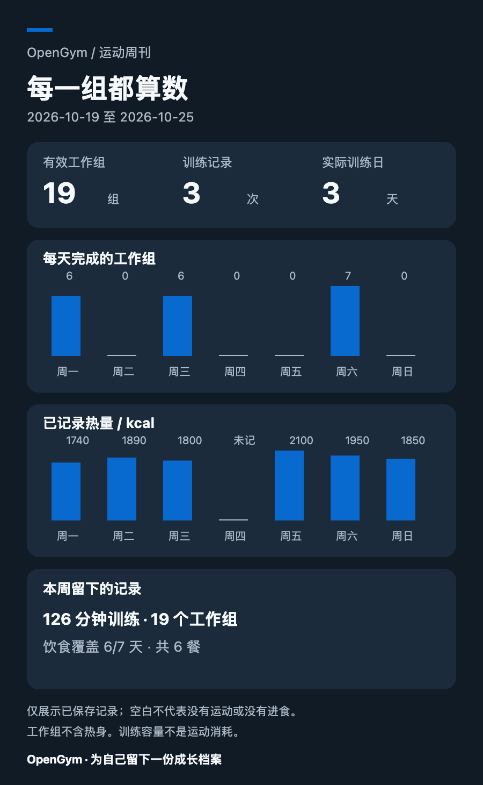
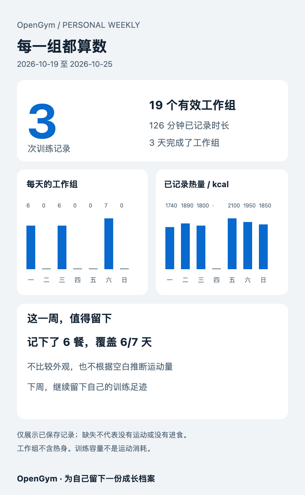
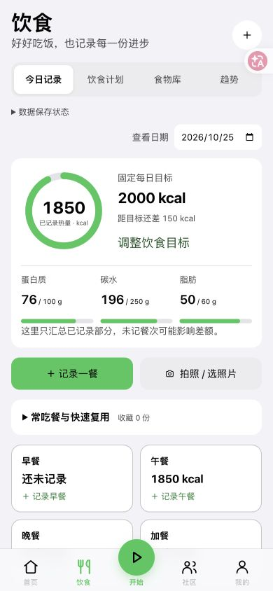
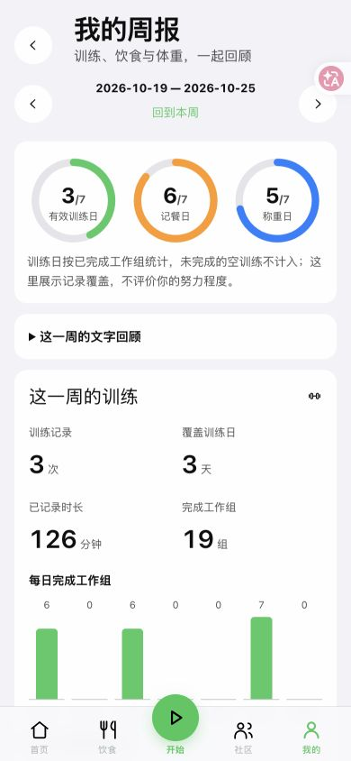

# 训练、饮食与周报体验升级 · 2026-10-25

本批围绕日常操作和可视化反馈迭代，保留现有账号、训练、饮食、会员卡及同步数据，不更换 Cloudflare，不新增付费依赖。

## 首页与开始训练

- 今日训练和「健身打卡」并排放在首页顶部。打卡原先的首页显示偏好仍有效；自定义首页可控制显示，位置固定在顶部。
- 热力图的13周和全年共用 **14 × 14 CSS像素** 格子、3像素间隔。13周居中，全年保持格子大小横向滚动；月份、星期、点击查看日期及时间／容量切换保留。
- 底部中间「开始」只进入预览页，不创建训练、不启动计时。预览显示今天的动作及组数，确认开始后才按原称重偏好进入训练；已有训练继续恢复。
- 首页的开始训练、其他训练选择同样增加确认，避免误触直接开始；正在进行的训练不会被第二次点击覆盖。
- 体重卡片增加醒目的「记录体重」主按钮。身体资料／BMI收起；曲线支持7／30／90天、全部，展示所选期间变化及末次记录前七天的记录均值。每天多次称重使用当天最后一次；目标线按需显示，避免远处目标挤压实际波动。

## 照片／地点打卡

拍照、从相册选择照片、手填地点均可打卡，照片和地点至少提供一种；不要求识别会员二维码。原会员卡钱包仍在打卡页折叠入口中，已有卡片不迁移、不删除。

- 仅主动点「获取当前位置」时才请求定位权限，不持续追踪；取到的坐标四舍五入到三位小数，手填地点同样有效。
- 照片经过现有图片压缩流程，不从照片自动读取GPS元数据。签到记录、照片与地点默认仅本人可见，不自动发布到社区，也不自动作为完成训练。
- 登录账号保存到当前用户的私有生活记录，其他用户不能用图片ID读取私人素材；访客保存在本机。
- 相同客户端请求重试不会重复保存；同一请求内容已改变时返回冲突，保留编辑输入。每日最多10次、累计最多3650条，延续已有媒体总容量限制。
- 最近显示30条，可导出完整文字和照片引用JSON。JSON不包含照片文件，亦不是新增了一个照片恢复工具。

## 可视化周报与分享

周报增加训练日／记餐日／称重日覆盖圆环，每日完成工作组和已记录时长柱图、热量柱图、蛋白质曲线及实际称重趋势。文字回顾折叠，数字摘要和图表优先。工作组不含热身；空训练记录不会增加「有效训练日」。

未记录和数值0分开显示。蛋白质缺失不画成零，均值只使用填写过蛋白质的日期；体重缺失日期不补造观测点。以上是已有记录的回顾，不根据空白、体重短期变化或照片评价努力程度、推断身体变化原因。

导出提供：

- **PNG**：900 × 1460，两套实际不同布局「运动数据卡」「周刊海报」，蓝／绿／橙配色。生成预览后再保存或分享，在本机免费生成。
- **TXT**：UTF-8，含分节标题、分隔线、数字汇总和逐日记录，适合复制或作为文件发送。
- **可选AI编排**：用户勾选说明、主动点击后才调用，AI从允许的布局、配色和标题中选择；原始统计数字始终由程序计算。只发送训练次数、天数、分钟、工作组和饮食／称重记录数量，不发送具体体重、照片、私信、昵称或逐餐明细。每天最多5次，与其他AI入口共用站点月额度，失败可继续用免费模板。
- 体重默认不导出；饮食汇总可取消。未勾选的内容同时从PNG和TXT中排除。记录变更、周次切换或选项变化后必须重新预览，不沿用旧海报。
- 网页支持时使用系统文件分享；移动工程沿用系统分享插件。微信、QQ、抖音是否出现在菜单由设备／应用支持决定，不能由网页保证；没有直接入口时下载图片或TXT后自行发送、发布。应用不会自动向别人发送或发布周报。

### 虚构记录生成的两套海报示例

以下均来自隔离测试账号，不是真实成员的训练、餐食或体重。

| 运动数据卡 | 周刊海报 |
| --- | --- |
|  |  |

## 饮食四分区

| 分区 | 已实现 |
| --- | --- |
| 今日记录 | 热量圆环、营养素实际量／目标、四餐入口、拍照与手动记录、常吃餐和前一天复用折叠入口 |
| 饮食计划 | 手动固定每日、训练／休息日、按周七日目标；热量与营养素分别填写；开始日期、历史版本和随后七天目标展示 |
| 食物库 | 自填每100克营养、分类与搜索、编辑／移除、按克数换算后加入待确认的一餐、最近记录食物；收藏条目移除不改写旧餐食 |
| 趋势 | 原有日／周／月／年摄入趋势与全年热量热力图，点击日期返回当日记录 |

计划不默认设置激进饮食目标。训练日取当前训练安排或当天训练记录；调整计划后目标跟随安排，已有餐食记录不变。计划保留生效历史并检查版本冲突；食物编辑检查更新时间，避免旧编辑静默覆盖。最多保存500个自填食物和365个计划历史版本。

截图参考中的公共食物大库、自动食谱、营养标签OCR、自动BMR／运动消耗、具名减脂方案和自动渐降碳水没有被冒充为已实现功能；目前采用自填数据和原有需确认的餐食AI识别。食物库与目标数据可以随饮食JSON导出，但当前已有「饮食备份恢复」接口仍只恢复其原先支持的餐食／常吃餐。

## 验证与发布边界

- 前端18个文件 **382项通过**：启动预览与称重流程、训练编辑／计时回归、热力图、体重、饮食分区、缺失数据、导出字段排除及原有成长／媒体交互。
- Node **23项通过**：打卡私密性、照片所有权、重试冲突、计划历史与食物隔离、AI同意及允许发送的字段，以及原有生活记录接口。
- Cloudflare **47项通过**：真实本地D1事务运行、私人照片权限、计划冲突、AI编排、原有邀请／消息／分享及1000模拟账号／30并发隔离检查。
- Chrome 390和320像素、浅／深色实际查看；测得两种训练热力图格子均14px，页面无文档横向溢出。虚构地点打卡已保存，饮食目标已生效。
- 两套PNG和TXT均实际下载；PNG中文与图表检查通过，未选择体重时TXT不含具体体重。AI用本地模拟服务验证，没有用真实用户数据调用付费模型。
- 网页构建与 Cloudflare preflight 后部署；生产文档另作本机私有备份，未在正式站插入虚构测试记录。
- 真实手机相机权限、GPS定位权限、微信／QQ／抖音实际接收、Safari及国产安卓浏览器仍需真机验收；浏览器窄屏检查不等于这些项目已通过。没有生成或发布新的签名APK／IPA。
- 新数据保存在原当前用户JSON文档内，无需数据库破坏性迁移。回退时不得恢复旧全库覆盖新记录，且继续保留1000邀请码支持。

